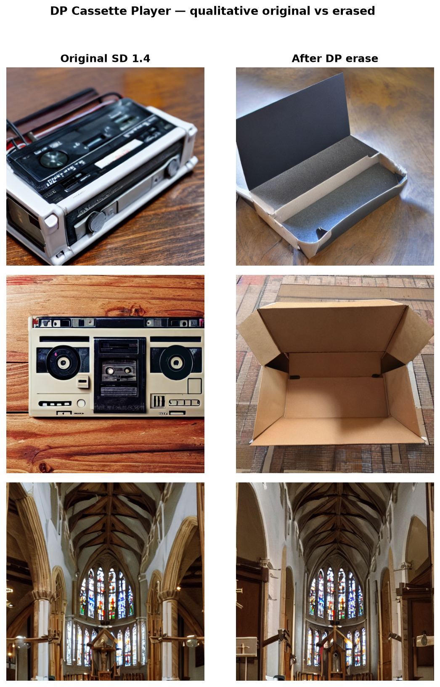
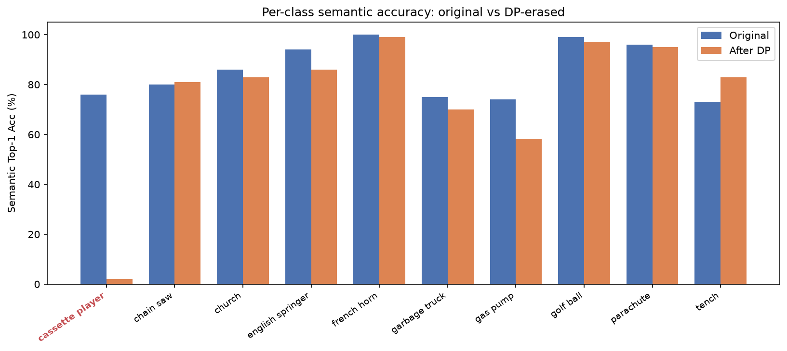
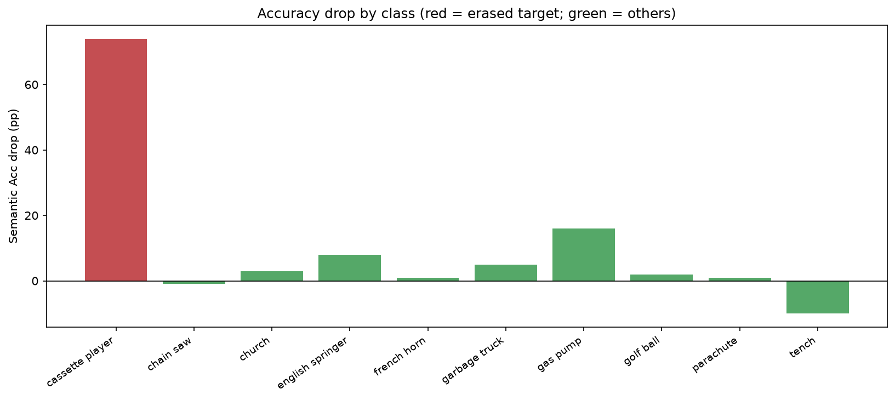
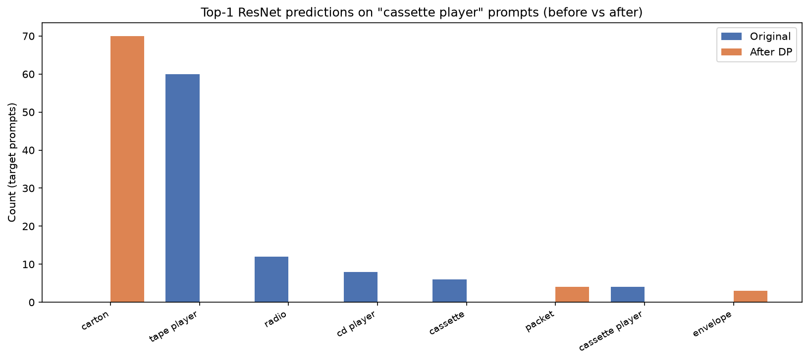

# Reproduction of Closed-Form Concept Erasure via Double Projections

**Object Erasure: Cassette Player on Stable Diffusion 1.4**

**Rafi Ahmed** · Machine Intelligence Lab, Sichuan University · September 2026

codewithrafi@outlook.com

---

## Overview

This repository documents a **reproduction study** of the *Double Projections (DP)* concept
erasure method (Zhang et al., CVPR 2026) applied to the **cassette player** object on
**Stable Diffusion 1.4**.

DP removes a target concept from a diffusion model **without any training**. It works in two
closed-form steps: the target's text embedding is first projected onto a *safe subspace* built
from a guide concept (*box* in this run), and the weight update is then constrained so it cannot
move any *preserved* concept. The edit runs in seconds and is fully deterministic.

Our run reproduces the paper's headline behavior: the target class collapses
(76.0% → 2.0% accuracy) while the other nine classes barely move (2.8% average drop).

## Results

### Key results at a glance

| Metric | Ours | Paper reference |
|---|---|---|
| Target accuracy, semantic (original → erased) | **76.0% → 2.0%** | 78.0% → 2.0% |
| Target accuracy, strict (original → erased) | 4.0% → 1.0% | 6.0% → 1.0% |
| Other classes, average drop | **2.8%** | 3.3% |

Semantic accuracy counts visually similar labels (e.g. *tape player*) as a match; strict
accuracy requires the exact class.

### Ours vs. the authors' reference

| Metric | Ours | Reference |
|---|---|---|
| Target Orig Acc (semantic) | 76.0% | 78.0% |
| Target Erased Acc (semantic) | **2.0%** | **2.0%** |
| Target Drop (semantic) | 74.0% | 76.0% |
| Target Orig Acc (strict) | 4.0% | 6.0% |
| Target Erased Acc (strict) | 1.0% | 1.0% |
| Other Orig Acc (avg) | 86.3% | 86.8% |
| Other Erased Acc (avg) | 83.6% | 83.4% |
| Other Average Drop | **2.8%** | 3.3% |

### Per-class detail

The average hides class-level variation: *gas pump* drops 16 points even though it is in the
preserve set — expected from positional-embedding coupling (see report, §1.4).

| Class | Original | Erased | Drop (pp) |
|---|---|---|---|
| cassette player *(target)* | 76 | **2** | 74 |
| gas pump | 74 | 58 | 16 |
| english springer | 94 | 86 | 8 |
| church | 86 | 83 | 3 |
| tench | 73 | 83 | −10 |

### Figures

**Qualitative results** — generated samples before and after erasure:

**Accuracy across all ten classes** (before vs. after, and the per-class drop):

**Where the target predictions go** — ResNet-50 labels on cassette-player prompts only:

## Reproduction setup

| Item | Value |
|---|---|
| Host | gpu-user0 |
| Environment | Conda `DP` (PyTorch 2.10.0+cu128) |
| GPU | RTX 5090, logical GPU 1 (`CUDA_VISIBLE_DEVICES=1`) |
| Base model | Local lean fp16 SD 1.4 (`variant="fp16"`) |
| Target / guide | cassette player / box |
| Preserve set | 9 other ImageNette classes |

**Pipeline (official DP code):**

1. Generate original SD 1.4 images (1000 samples, ≈24m39s).
2. Apply the closed-form DP edit (seconds).
3. Generate erased images (1000 samples, ≈25m18s).
4. Score both sets with ResNet-50 semantic Top-1.

## Repository layout

| Path | Contents |
|---|---|
| [`source_code/`](source_code/) | Code used for the run (SD 1.4 track), including our `compare_accuracy.py` and `make_eval_figures.py` |
| [`figures_cassette_player/`](figures_cassette_player/) | Figures, prediction CSVs and the summary |
| [`report/`](report/DP_Report_CassettePlayer.pdf) | Full reproduction report (PDF) |
| [`models/`](models/) | Checkpoint placeholder — weights are not committed, see [`models/README.md`](models/README.md) |
| [`index.html`](index.html) | [Project page](https://codewith-rafi.github.io/dp-concept-erasure/) source |

## Getting the model weights

The checkpoints (≈24 GB) are **not** committed. See [`models/README.md`](models/README.md) for
what to download and where to place it.

## Reproducing

1. Install the requirements from [`source_code/requirements.txt`](source_code/requirements.txt).
2. Download the SD 1.4 weights into `models/` (see above).
3. Run the erasure and evaluation scripts under [`source_code/SD/`](source_code/SD/).

## References

- Zhang, Cheng, Wang, and Liu. [Closed-Form Concept Erasure via Double Projections](https://github.com/czhang024/CVPR_DouleProjection). CVPR 2026. [arXiv](https://arxiv.org/abs/2604.10032)
- Gandikota et al. [Unified Concept Editing in Diffusion Models (UCE)](https://arxiv.org/abs/2308.02508). WACV 2024.
- Orgad, Kawar, and Belinkov. [Editing Implicit Assumptions in Text-to-Image Diffusion Models (TIME)](https://arxiv.org/abs/2303.08084). ICCV 2023.
- Kumari et al. [Ablating Concepts in Text-to-Image Diffusion Models](https://arxiv.org/abs/2303.13516). ICCV 2023.
- Gandikota et al. [Erasing Concepts from Diffusion Models (ESD)](https://arxiv.org/abs/2303.07345). ICCV 2023.
- Meng et al. [Mass-Editing Memory in a Transformer (MEMIT)](https://arxiv.org/abs/2203.07206). ICLR 2023.
